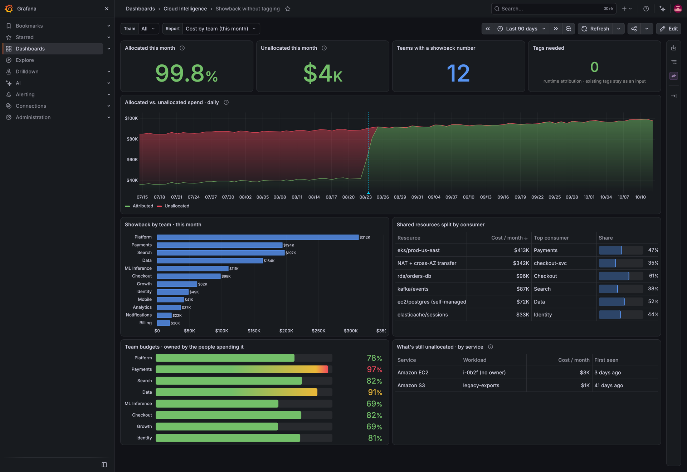
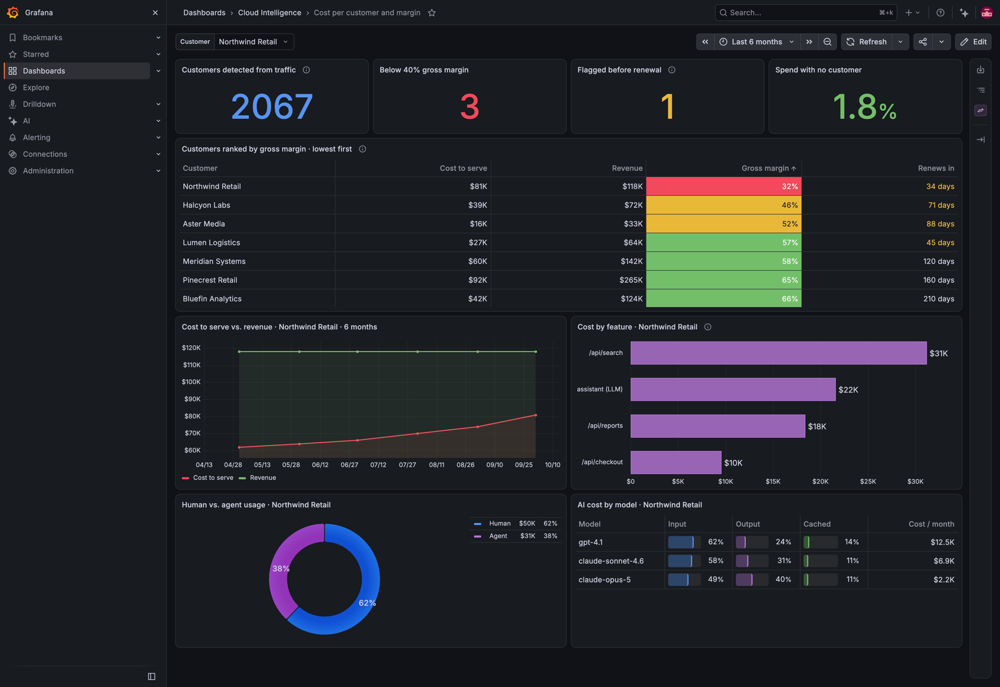
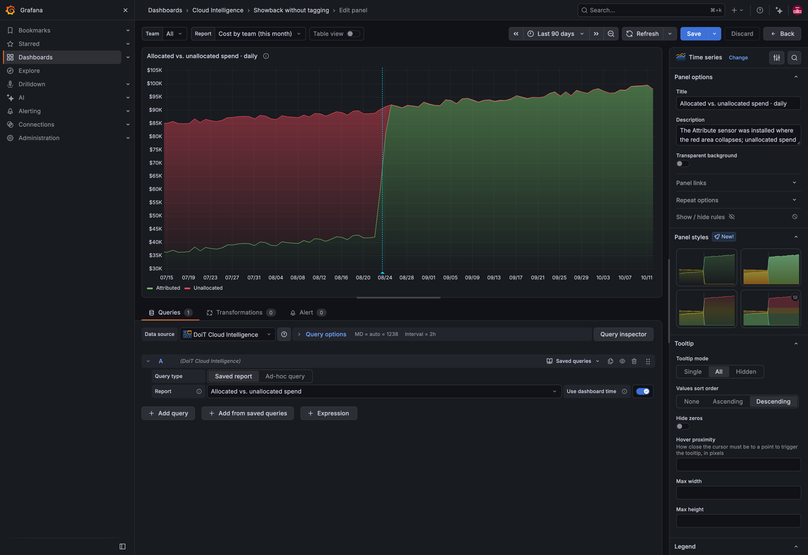
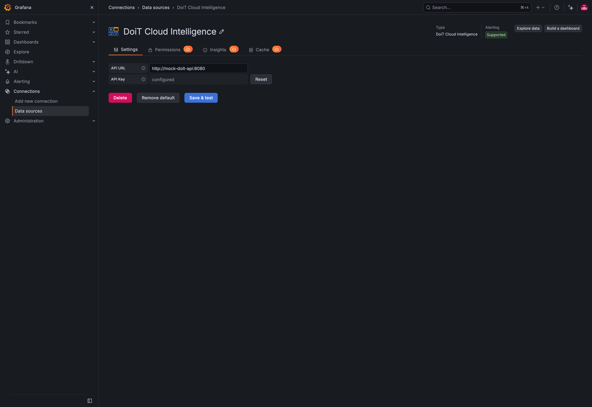

# Tutorial: FinOps dashboards without tagging

Two Grafana dashboards built on the Cloud Intelligence™ data source plugin and Attribute™ runtime cost attribution:

1. **Showback without tagging** — how much of the bill is still unowned, and what each team actually consumes.
2. **Cost per customer and margin** — what every customer costs to serve, which ones are underpriced, and what drives it.

Both ship as importable JSON in [`dashboards/`](dashboards/), and this folder also contains a self-contained demo stack (Grafana + a mock of the DoiT API with sample data) so you can run them without a DoiT account.





## How the data gets to Grafana

Attribute deploys an eBPF sensor that observes traffic to every cloud resource and reads customer, tenant and feature identifiers from the requests themselves. Cloud Intelligence joins that with billing data and exposes the result in Cloud Analytics as ordinary report dimensions:

| Dimension family | Examples | Use it for |
|---|---|---|
| Workload | Platform type, platform name, workload namespace, workload type, workload name | Showback by team, shared-resource splits |
| Identifier | Customer, tenant, feature, or any key your traffic carries | Cost per customer, cost by feature |
| Allocation status | Attributed / Unallocated | The unallocated bucket, and driving it to zero |

Anything the sensor cannot attribute lands in an explicit **Unallocated** bucket instead of being pro-rated across everyone.

> **Availability.** Attribute dimensions in Cloud Analytics reports are in release preview for AWS at the time of writing and are enabled per account. The plugin does not care which dimensions a report uses, so the dashboards below work as soon as the dimensions are enabled for you.

Every Cloud Analytics report is available in the plugin's query editor, follows the Grafana time picker, and works with Grafana Alerting. That is the whole bridge: **build the report once in Cloud Intelligence, pick it from the dropdown in Grafana.**



## Run the demo stack

The demo uses a tiny Python mock of the DoiT API ([`mock-api/server.py`](mock-api/server.py)) that serves the sample data shown in the screenshots. Nothing talks to api.doit.com.

```bash
# from the repository root
npm install && npm run build
mage build:linuxARM64            # or mage build:linux on amd64 hosts
docker compose -f examples/attribute-dashboards/docker-compose.yaml up --build
```

Open <http://localhost:3000> (admin / admin). The data source and both dashboards are provisioned under the **Cloud Intelligence** folder. Set `GRAFANA_PORT` to use another port and `GRAFANA_VERSION` to pick a Grafana image tag (default 13.1.0; the screenshots use 13.2.2).

The data source points at `http://mock-doit-api:8080` with a dummy token; swap in `https://api.doit.com` and a real token to run the same dashboards against your account.



## Dashboard 1: Showback without tagging

### Reports to create in Cloud Intelligence

| Report | Metric | Group by | Time | Used by |
|---|---|---|---|---|
| Allocated vs. unallocated spend | Cost | Allocation status | Daily | Stacked time series |
| Allocated share of spend (this month) | Cost (share) | — | This month | Stat |
| Unallocated spend (this month) | Cost | Filter: Unallocated | This month | Stat |
| Cost by team (this month) | Cost | Team (workload namespace or identifier) | This month | Bar chart, stat (count) |
| Team budget utilization | Cost ÷ budget | Team | This month | Bar gauge |
| Shared resources split by consumer | Cost, share | Resource, top consumer | This month | Table |
| Unallocated spend by service | Cost | Service, workload | This month | Table |

Reports without a time interval come back as tables; reports with a time interval come back as one time series per group. The plugin handles both automatically.

### Panels

- **Stats (row 1).** Stat panels on the single-value reports. `Teams with a showback number` is a stat over *Cost by team* with the `count` reducer. The `Tags needed` panel is a text panel.
- **Allocated vs. unallocated (row 2).** Time series, stacking *Normal*, fill 55%, display name `${__field.labels.allocation_status}`, overrides coloring *Unallocated* red and *Attributed* green. Add an annotation on the day the sensor was installed; the red area collapses there.
- **Showback by team.** Horizontal bar chart on *Cost by team*, values always shown.
- **Shared resources split by consumer.** Table; `Share` column uses the *Gauge* cell type with text value, cost column formatted as currency, sorted by cost.
- **Team budgets.** Bar gauge on *Team budget utilization*, unit percent (0.0–1.0), thresholds at 85% (amber) and 95% (red), display name `${__data.fields.team}`, *All values* enabled.
- **What's still unallocated.** Table on *Unallocated spend by service*. Keep it on the board so it stays empty.

### Variables and alerts

- `team` — query variable `dimension_values(identifier, team)`; `report` — `reports()`.
- Alert rule on the *Unallocated* series: reduce **last**, threshold **above 2% of total**, pending period **2d**. New workloads that resolve to no owner surface here within a day.

## Dashboard 2: Cost per customer and margin

### Reports to create in Cloud Intelligence

| Report | Metric | Group by | Time | Used by |
|---|---|---|---|---|
| Cost to serve and margin by customer | Cost, revenue (DataHub), margin | Identifier: customer | This month | Table |
| Cost to serve vs. revenue (per customer) | Cost, revenue (DataHub) | Identifier: customer, filtered by `$customer` | Monthly, 6 months | Time series |
| Cost by feature (per customer) | Cost | Identifier: feature | This month | Bar chart |
| Human vs. agent usage (per customer) | Cost | Usage type | This month | Pie |
| AI cost by model (per customer) | Cost, token shares | Model | This month | Table |
| Customers detected / below target / flagged / no-customer share | Counts and share | — | This month | Stats |

Revenue per customer reaches Cloud Intelligence through [DataHub](https://help.doit.com/docs/integrations/datahub) (CSV upload or the DataHub API from your billing system). Margin is computed in the report.

### Panels

- **Customers ranked by gross margin.** Table sorted ascending by margin. `Gross margin` uses the *Colored background* cell type with thresholds red < 40%, amber 40–55%, green > 55%. `Renews in` uses *Colored text*, amber under 90 days.
- **Cost to serve vs. revenue.** Time series with two series; red for cost, green for revenue, points shown.
- **Cost by feature.** Horizontal bar chart. Features come from API paths and model calls in the traffic.
- **Human vs. agent usage.** Pie (donut), *All values*, legend as table with value and percent.
- **AI cost by model.** Table with *Gauge* cells for input, output and cached token shares.

### Variables and alerts

- `customer` — query variable `dimension_values(identifier, customer)`; the lower two rows follow it.
- Alert rule on *Cost to serve and margin by customer*: fire when trailing margin is under target and renewal is within 90 days.

## Import the dashboards into your own Grafana

1. Install the plugin from **Administration → Plugins and data → Plugins** and add a **DoiT Cloud Intelligence** data source with a token that has the Cloud Analytics User permission (a service account token is recommended).
2. Create the reports above in Cloud Analytics, or open the matching preset reports.
3. **Dashboards → New → Import**, upload a file from [`dashboards/`](dashboards/), and select your data source when prompted.
4. In each panel, pick your report from the **Report** dropdown. Report IDs differ per account, so this is the one manual step.

Tip: every report in Cloud Intelligence has an **Open in Grafana** action that generates a one-panel dashboard JSON for the plugin; it is a quick way to grab a report ID and a working panel.

## Regenerate the screenshots

```bash
GRAFANA_URL=http://localhost:3000 OUT=examples/attribute-dashboards/img node examples/attribute-dashboards/screenshots.mjs
```

The script logs in as admin, adds the sensor-install annotation, and captures both dashboards, the panel editor and the data source page at 2× scale. It uses the `@playwright/test` dependency already in this repository.

## What is sample data

Every number in the demo is illustrative and served by the mock API. Figures such as the 43% tagging coverage baseline and the example resources mirror DoiT's product materials; they are not from a real customer.
